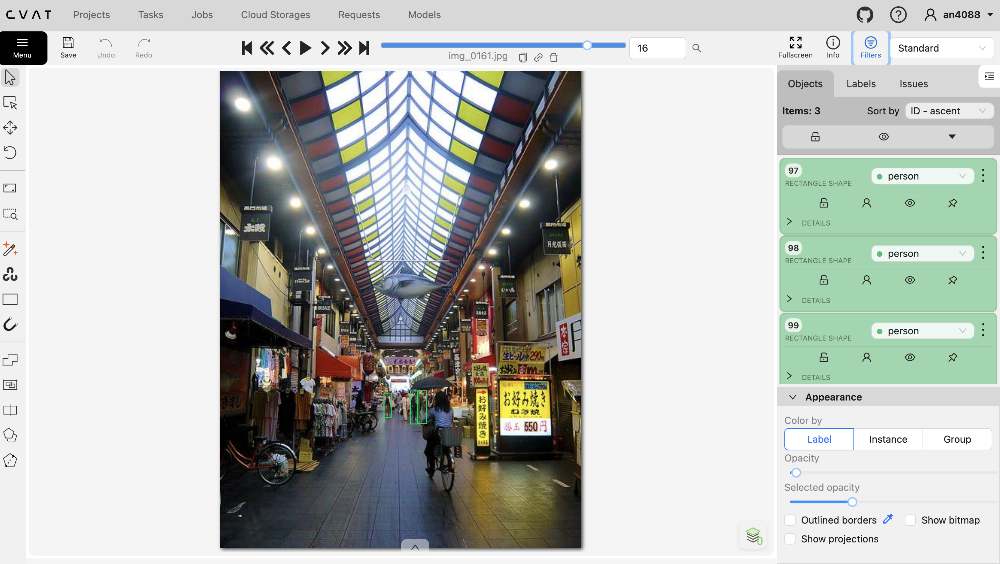

# Báo cáo Day 09 — Nguyễn Thị Thúy An, 2A202603094

## 1. Kết luận trước

**Hold.** Vào 224 ảnh, loại 22 ở bước nhận dữ liệu, xuất 202 ảnh (bản nháp, chưa phát hành).
Lý do: sau khi sửa tự động và duyệt, không còn lỗi bắt buộc nhưng 38/202 ảnh (18,8%) còn cảnh báo, vượt ngưỡng 10%. Hàng đợi người duyệt có 125 ảnh, vượt ngân sách 80 ảnh.

## 2. Lỗi và phân việc

| Mã lỗi | Số ảnh/dòng | Ai sửa | Vì sao |
|---|---:|---|---|
| DUP_IMAGE_EXACT, DUP_IMAGE_NEAR, LEAK_TEST, BAD_SIZE, CORRUPT_IMAGE | 8, 4, 5, 3, 2 ảnh | máy (loại ảnh) | trùng, rò rỉ test, quá nhỏ hoặc hỏng: giữ lại chỉ có hại |
| BAD_CLASS_ID, BAD_FORMAT, BOX_ZERO, DUP_BOX | 6, 3, 4, 7 ảnh (20 dòng) | máy (xoá dòng) | dòng hỏng không sửa được, dòng lặp thì dư |
| BOX_OUT_OF_IMAGE | 8 ảnh | máy (cắt box về trong ảnh) | chỉ bỏ phần ngoài ảnh, giữ nguyên lớp |
| BAD_CLASS_NAME | 1 (`data.yaml`) | máy (ghi lại tên lớp) | đưa về đúng 4 lớp của dự án |
| MISSING_LABEL_FILE | 6 ảnh | **người** | máy không được bịa nhãn |
| POSSIBLE_MISSING, WRONG_CLASS, FALSE_POS, LOOSE_BOX | 52, 18, 27, 24 ảnh | **người** | lỗi về ý nghĩa, máy chỉ cảnh báo |

**Vì sao xếp như vậy:** điểm ưu tiên của một ảnh là tổng trọng số các mã lỗi của nó (`configs/pipeline.yaml`). `NEEDS_LABEL` có trọng số cao nhất (10) nên 6 ảnh thiếu file nhãn đứng ngay sau `img_0020` (ảnh dính 3 mã lỗi).
**Người xem được bao nhiêu:** ngân sách 80 ảnh trên 125 ảnh trong hàng đợi. Người xem hết 52/52 ảnh POSSIBLE_MISSING, 18/18 WRONG_CLASS, 6/6 thiếu file nhãn nhưng chỉ 12/23 FALSE_POS và 6/24 LOOSE_BOX. 45 ảnh không ai xem.

## 3. Calibration (2 ngưỡng)

| Tham số | Khởi đầu | Đã chọn | Precision / Recall (trước → sau, trên bộ calib) | Lý do (đánh đổi) |
|---|---|---|---|---|
| `duplicates.phash_dist` | 2 | **10** | ảnh gần trùng: 1,00 / 0,50 → 1,00 / 0,67 | Ảnh bị xoá tự động nên cần precision 1,00 (không xoá nhầm). Từ 10 đến 15 kết quả như nhau, chọn đầu vùng. |
| `second_opinion.conf` | 0,25 | **0,6** | thiếu nhãn: 0,50 / 1,00 → 0,57 / 1,00 | Giá trị cao nhất mà vẫn không bỏ sót lỗi thiếu nhãn (recall 1,00). Từ 0,7 bắt đầu sót. |

**Chỗ calibration có thể đánh lừa:** trên bộ calib, `phash_dist = 16` trông tốt hơn 10 (recall gần trùng 0,83, precision vẫn 1,00). Nhưng bộ calib chỉ có 39 ảnh nên ít cặp "giống tình cờ". Trên raw (224 ảnh), 16 cờ thêm 3 cặp ảnh (12 → 15 ảnh). Tôi mở xem 3 cặp đó: chỉ 1 cặp là trùng thật, 2 cặp là hai ảnh khác nhau. Vì vậy tôi giữ 10.
Tương tự, `conf = 0,8` làm tỉ lệ ảnh còn cảnh báo giảm từ 18,8% xuống 8,9% và kết luận chuyển sang Release (thí nghiệm thử trên bản sao cấu hình, không phải kết quả nộp). Nhưng recall lỗi thiếu nhãn tụt từ 1,00 xuống 0,75 (`calibration.json`), nghĩa là máy bỏ sót nhiều hơn chứ chưa chắc dữ liệu sạch hơn. Tôi giữ 0,6 và báo Hold.

## 4. Cửa chặn và điều pipeline KHÔNG bắt được

**(a)** Chạy `python -m pipeline.run --budget 0 --reports work/rep_nb --export-dir work/exp_nb`: không có người duyệt nên 6 ảnh thiếu file nhãn còn nguyên. Kết quả: **Rework** ("còn 6 lỗi bắt buộc chưa sửa"), mã thoát **20**, và **không xuất** dataset (không tạo `work/exp_nb`).

**(b)** Trong 8 ảnh tôi tự thấy lỗi ở Bước 1, pipeline bắt được 5 và để lọt 3. Ba chỗ lọt là các điểm mù:
1. **Nhầm lớp mà máy không phản đối** (`img_0002`: động cơ thuyền gán `person`; `img_0005`: person 5 không phải người). Cả hai không bị cờ gì và không vào hàng đợi.
2. **Thiếu nhãn không bị cờ** (`img_0006`: thiếu người cầm gậy bóng chày). Chỉ bị cờ `DUP_BOX` (máy xoá dòng), không có cảnh báo thiếu nhãn ở `conf = 0,6`, và ảnh nằm ngoài 80 ảnh được duyệt.
3. **Box lỏng:** trên bộ calib, F1 của cảnh báo box lỏng chỉ đạt tối đa 0,46, nên máy bắt kém loại lỗi này.

## 5. Train: raw vs clean (tùy chọn, chấm riêng)

Model `yolo26n`, 20 epoch, 2 seed, cùng tập val và test (100 ảnh).

| Biến thể | Số ảnh train | mAP50 (trung bình ± độ lệch giữa 2 seed) |
|---|---:|---|
| raw | 224 | 0,726 ± 0,000 |
| clean | 202 | 0,701 ± 0,023 |

**Kết luận:** chênh mAP50 (clean − raw) = −0,025, gần bằng độ lệch giữa 2 seed của clean (0,023), nên **chưa kết luận được** clean tốt hơn hay kém hơn raw. Ít nhất là không có bằng chứng pipeline làm model tốt hơn.

**Giả thuyết và cách kiểm:**
1. `raw` chứa 5 ảnh rò rỉ từ test nên điểm có thể bị thổi phồng. Kiểm: train lại `raw` sau khi bỏ 5 ảnh đó.
2. `clean` ít ảnh hơn (202 so với 224) và lớp `truck` giảm mạnh nhất (AP50 0,589 và 0,494 so với 0,657 và 0,640 của raw), có thể vì ít box. Kiểm: đếm box theo lớp, thêm seed.
3. Test chỉ 100 ảnh và mới 2 seed nên số đo dao động lớn. Kiểm: chạy thêm seed.

## 6. Quyết định và ghi chú AI

**(a)** Quyết định cuối: **Hold**, không phát hành `clean_v1`. Để thành Release cần đưa số ảnh còn cảnh báo từ 38 xuống ≤ 20 (10% của 202), bằng cách: tăng ngân sách duyệt (hàng đợi 125 so với 80 ảnh) và xử lý các cảnh báo FALSE_POS (21 ảnh) và LOOSE_BOX (23 ảnh) còn lại. Không đổi ngưỡng Hold, ngân sách hay script người duyệt.

**(b)** Có dùng AI (Claude Code) để viết 4 module `label_format`, `gate`, `autofix`, `second_opinion`.
- **Prompt chính:** nhờ AI viết lần lượt từng module theo thứ tự trong GUIDE, mỗi lần dựa trên docstring và file test của module đó (theo `docs/PROMPTING.md`: nêu đủ định dạng vào, quy tắc kiểm, kiểu in ra, giới hạn an toàn), với yêu cầu ngưỡng lấy từ `cfg`, không viết cứng.
- **Cách kiểm:** chạy `pytest` từng module (14, 10, 11, 15 test) rồi toàn bộ 79 test; đọc lướt xem có xoá/ghi đè file ngoài ý muốn không (chỉ `autofix` xoá và chỉ ảnh có lỗi loại bỏ), có `except: pass` không (không có), có ngưỡng viết cứng không (không có); chạy thêm các ca ngoài test (4 ca cho `label_format`, 7 cho `gate`, 8 cho `autofix`, 7 cho `second_opinion`) trên dữ liệu tạm rồi chạy `make run` và mở ảnh để đối chiếu.
- **1 lần AI sai:** khi thử `second_opinion` với nhiều dự đoán, AI dựng dữ liệu thử có box nhãn "lỏng" quá rộng (IoU chỉ 0,26 < `iou_missing` 0,3) nên kết quả ra `MISSING` và `FALSE_POS` thay vì `LOOSE_BOX` như dự kiến. Tôi tính lại IoU để xác nhận code đúng và dữ liệu thử sai, rồi thu nhỏ box (IoU 0,39) thì ra đúng `LOOSE_BOX`. Không có lỗi nào trong 4 module nộp.

**Thưởng +2 (CVAT, lọc `width < 20`).** Tôi tạo task 20 ảnh trên CVAT (5 ảnh có `BOX_TINY` và 15 ảnh đầu hàng đợi), import nhãn YOLO 1.1 rồi đặt rule `Width < 20`. Khi tạo nhãn, CVAT cloud không nhận `"values": []` của thuộc tính checkbox nên trong phiên CVAT tôi dùng `["false"]`; `cvat/labels.json` trong repo giữ nguyên.

- **Khớp bộ lọc:** 23 box trên 7 ảnh: `img_0020` (4), `img_0026` (6), `img_0030` (4), `img_0051` (3), `img_0069` (2), `img_0078` (1), `img_0161` (3). Ví dụ `img_0161` có 4 box nhưng chỉ 3 box khớp (ảnh chụp).
- **Đối chiếu `BOX_TINY`:** pipeline cờ 7 box (`img_0026`, `img_0030`, `img_0051`, `img_0069`, `img_0161`), cả 7 đều nằm trong 23 box của CVAT, cùng ảnh. 16 box còn lại (rộng 12 đến 20 px) chỉ CVAT thấy vì ngưỡng 20 px cao hơn 12 px của pipeline, và CVAT đo chiều rộng còn pipeline đo cạnh ngắn.
- **`can_review`:** người gán đặt `can_review=true` khi gặp box khó cần người khác xem lại; pipeline có thông tin tương tự ở `05_review_queue.csv` (cột `codes` và điểm ưu tiên) để chọn ảnh đưa cho người duyệt.
